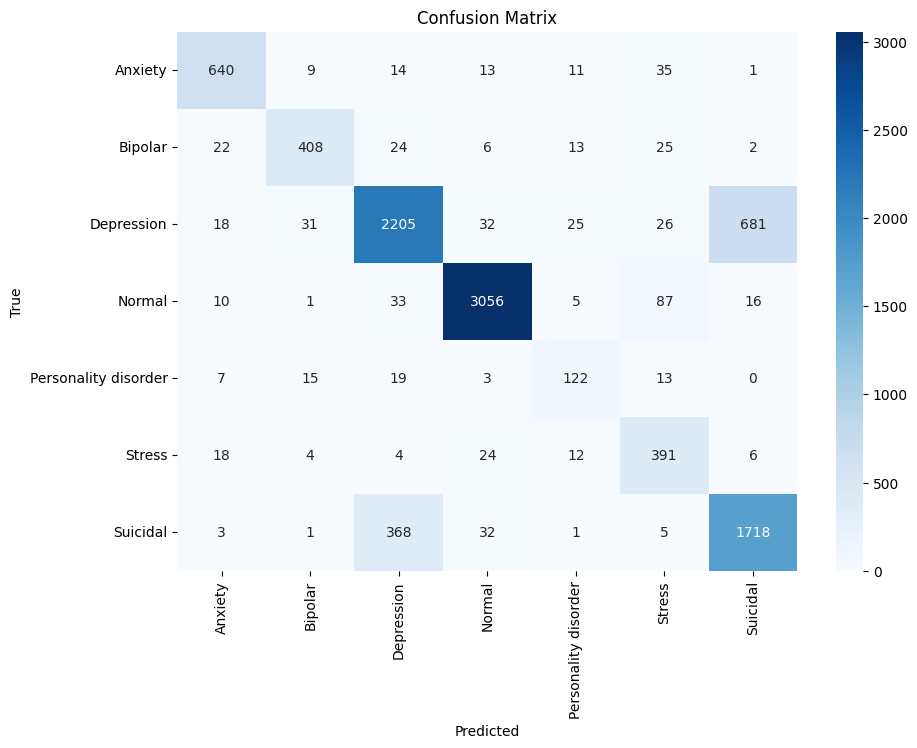
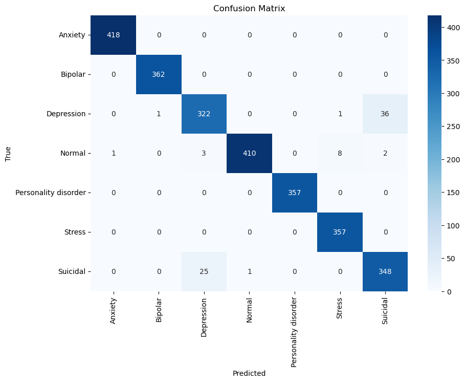
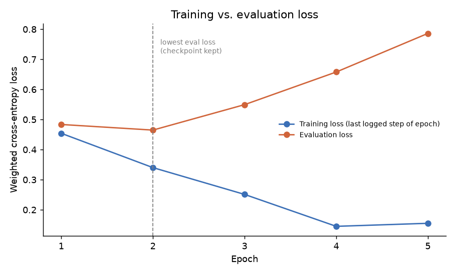

# BERT Fine-Tuning for 7-Class Mental Health Text Classification

Fine-tuning `bert-base-uncased` to classify short personal statements into one of seven mental-health categories:
**Anxiety, Bipolar, Depression, Normal, Personality disorder, Stress, Suicidal**.

The interesting part of this project wasn't the model. It was finding and fixing evaluation problems in my first version,
which had reported **97% accuracy** because of data leakage. After fixing it, the honest number on a clean held-out set is **84% accuracy / 0.80 macro-F1**.

> ⚠️ **Not a diagnostic tool.** This is a learning project trained on public, crowd-sourced social-media text.
> It must not be used to assess or make decisions about real people. If you or someone you know is struggling,
> please reach out to a local helpline or a mental-health professional.

---

## Results

Evaluated on **10,215 held-out statements** (20% stratified split, no duplicate statements shared with the training set).

| Metric | Score |
|---|---|
| Accuracy | **0.84** |
| Macro-F1 | **0.80** |
| Weighted-F1 | 0.84 |

<details>
<summary>Per-class report</summary>

| Class | Precision | Recall | F1 | Support |
|---|---|---|---|---|
| Anxiety | 0.89 | 0.89 | 0.89 | 723 |
| Bipolar | 0.87 | 0.82 | 0.84 | 500 |
| Depression | 0.83 | 0.73 | 0.78 | 3,018 |
| Normal | 0.97 | 0.95 | 0.96 | 3,208 |
| Personality disorder | 0.65 | 0.68 | 0.66 | 179 |
| Stress | 0.67 | 0.85 | 0.75 | 459 |
| Suicidal | 0.71 | 0.81 | 0.75 | 2,128 |

Raw output: [`results/classification_report.txt`](results/classification_report.txt)
</details>

<p align="center">
  
</p>

**What the confusion matrix shows:** most of the errors come from one pair of classes. Depression and Suicidal
are confused with each other 1,049 times (681 + 368), which is **about 63% of all 1,675 errors**. That makes sense, because
the two classes use very similar language in this dataset. Normal is the easiest class (F1 0.96).
The smallest class, Personality disorder (179 test examples), is the hardest (F1 0.66).

---

## How the project evolved: 97% → 75% → 84%

The project went through three versions. All three notebooks are in this repo, so each step can be checked.

| | v0: [leaky](notebooks/archive/v0_leaky_oversampling.ipynb) | v1: [split fixed](notebooks/archive/v1_split_before_oversampling.ipynb) | v2: [final](notebooks/mental_health_bert.ipynb) |
|---|---|---|---|
| Data | 6,000-row random sample | 6,000-row random sample | full dataset, 51,072 rows after deduplication |
| Cleaning | NLTK stopwords + strip non-letters | NLTK stopwords + strip non-letters | lowercase, strip URLs, collapse whitespace |
| Imbalance | `RandomOverSampler` on **all** data, **then** split | split, then `RandomOverSampler` on train only | class-weighted loss, no copies |
| Sequence length | fixed padding to 200 | fixed padding to 200 | dynamic padding, max 512 |
| Test set | 2,652 rows (contains oversampled copies) | 1,200 rows | 10,215 rows |
| **Accuracy / macro-F1** | **0.97 / 0.97** ❌ leaked | 0.75 / 0.72 | **0.84 / 0.80** |

*The three test sets are different, so the v1 and v2 numbers aren't a strict comparison. v2 is trained and tested on ~8× more data.
For notes on how the archived notebooks were run and trimmed, see [`notebooks/archive/README.md`](notebooks/archive/README.md).*

### 1. Oversampling before splitting leaked the test set (v0 → v1)

v0 balanced the classes by duplicating rows from the smaller classes, which grew 6,000 rows into 13,258, and only *then* split into train and test.
Personality disorder, for example, went from 131 real posts to 1,894 rows, so about 14 copies of each post. After a random split,
almost every test example from the heavily oversampled classes had an identical copy in the training set, so the model was graded on posts it had already seen.
The pattern in v0's report shows this: the classes that were copied the most (Anxiety, Bipolar, Personality disorder) score a perfect **1.00**,
while Depression and Suicidal, which were barely oversampled, score only 0.91–0.92.
Doing the split first, and oversampling only the training set, brought accuracy down to an honest **75%**.

<p align="center">
  
  <br><sub>v0: near-perfect scores on the rare classes are a sign of leakage, not a good model.</sub>
</p>

### 2. Stopword removal was deleting negations (v1 → v2)

NLTK's English stopword list includes *not*, *no* and *nor*, so *"I am not depressed"* became *"depressed"*, which flips the meaning.
BERT is pretrained on natural sentences and uses these words, so v2 does only light cleaning (lowercase, strip URLs, collapse whitespace)
and leaves the rest to BERT's tokenizer.

### 3. Fixed length 200 was truncating long posts (v1 → v2)

Measured on a 2,000-post sample of the training set, the median post is 76 tokens, but **22.2% are longer than 200 tokens**. v1 cut all of those off.
v2 truncates only at BERT's 512-token limit and pads each batch to its own longest post (`DataCollatorWithPadding`), which also avoids wasting compute on padding.

### 4. Other v2 changes

- Used the **full dataset** instead of a 6,000-row sample, and **removed 1,608 duplicate statements before splitting**, so duplicates in the raw data can't leak either.
- Replaced oversampling with a **class-weighted loss** (see below), so no rows are copied at all.

---

## Pipeline

```
Combined Data.csv (52,681 rows after dropping NaNs)
   │  drop 1,608 duplicate statements             → 51,073
   │  light cleaning (lowercase, strip URLs, whitespace), drop empty → 51,072
   │  label-encode 7 classes
   │  stratified 80/20 split (random_state=42)    → 40,857 train / 10,215 test
   │  tokenize with bert-base-uncased (no padding, truncate at 512)
   ▼
BertForSequenceClassification + weighted cross-entropy
   ▼
evaluate on test set → classification report + confusion matrix
```

### Class imbalance

The classes are very unbalanced (Normal has 16,039 examples, Personality disorder only 895). I used sklearn's
`"balanced"` class weights, then took their **square root** to soften them. The full balanced weights over-corrected
and pushed too many predictions toward the rare classes.

| Class | Train weight (√balanced) |
|---|---|
| Anxiety | 1.420 |
| Bipolar | 1.708 |
| Depression | 0.695 |
| Normal | 0.674 |
| Personality disorder | 2.855 |
| Stress | 1.784 |
| Suicidal | 0.828 |

### Training setup

| Setting | Value |
|---|---|
| Base model | `bert-base-uncased` |
| Optimizer / LR | AdamW (HF default), 2e-5, linear schedule, 500 warmup steps |
| Batch size | 16 (train), 32 (eval) |
| Epochs | 5, keeping the checkpoint with the **lowest eval loss** (epoch 2) |
| Weight decay | 0.01 |
| Precision | fp16 |
| Hardware | Google Colab, 1× Tesla T4 (~1 h 29 min) |

<p align="center">
  
</p>

Evaluation loss is lowest at epoch 2 and rises after that while training loss keeps falling, so the model starts
overfitting after epoch 2. The epoch-2 checkpoint is the one saved and evaluated. Per-epoch numbers are in [`results/training_log.csv`](results/training_log.csv).

---

## Limitations (please read)

I'm listing these because they affect how far the 84% number can be trusted.

1. **The test set was also used to pick the checkpoint.** `Trainer` evaluated on the test split after every epoch, and
   `load_best_model_at_end` kept the epoch with the lowest loss on it. Only 5 checkpoints were compared, and the comparison used loss rather than accuracy,
   so the optimistic bias should be small, but it isn't zero. A cleaner setup would be a separate train/validation/test split.
2. **It doesn't hold up well on text I wrote myself.** In an informal check with 5 statements I wrote (end of the notebook),
   only **2 out of 5** were classified correctly. The model predicted *Stress* for most of them, including a clearly suicidal statement
   (P(Stress) = 0.875, P(Suicidal) = 0.010). The 84% reflects performance on text that looks like the dataset,
   not on real-world language in general.
3. **Duplicates were removed before cleaning.** Two statements that differ only in capitalization or URLs would survive
   deduplication and could end up on opposite sides of the split. I expect few such cases, but I haven't measured it.
4. **Label quality.** The dataset combines several public sources, and its labels come from where each post was collected,
   not from clinical assessment.

---

## Repository structure

```
├── notebooks/
│   ├── mental_health_bert.ipynb   # v2: final pipeline with outputs (Google Colab)
│   └── archive/                   # v0 (leaky) and v1 notebooks, kept as evidence
├── src/
│   └── predict.py                 # command-line inference using the saved model
├── results/
│   ├── classification_report.txt
│   └── training_log.csv
├── assets/
│   ├── confusion_matrix.png
│   └── training_curve.png
└── requirements.txt
```

## Running it

**Train:** open `notebooks/mental_health_bert.ipynb` in Google Colab with a T4 GPU, put `Combined Data.csv` in your
Drive, and update `CSV_PATH` / `SAVE_DIR` in the second cell. To do a quick test run first, set `SAMPLE_SIZE = 2000`.

**Predict:** the trained weights (~420 MB) aren't published. Running the notebook produces them in `SAVE_DIR`.
Then:

```bash
pip install -r requirements.txt
python src/predict.py --model-dir path/to/saved_mental_status_bert --probs "I can't stop worrying about tomorrow"
```

## Dataset

[Sentiment Analysis for Mental Health](https://www.kaggle.com/datasets/suchintikasarkar/sentiment-analysis-for-mental-health)
on Kaggle (file `Combined Data.csv`), which combines several public mental-health text datasets. The dataset isn't
redistributed here. Please download it from Kaggle and follow its license.

## Tech stack

Python · PyTorch · Hugging Face Transformers & Datasets · scikit-learn · pandas · Matplotlib / Seaborn
